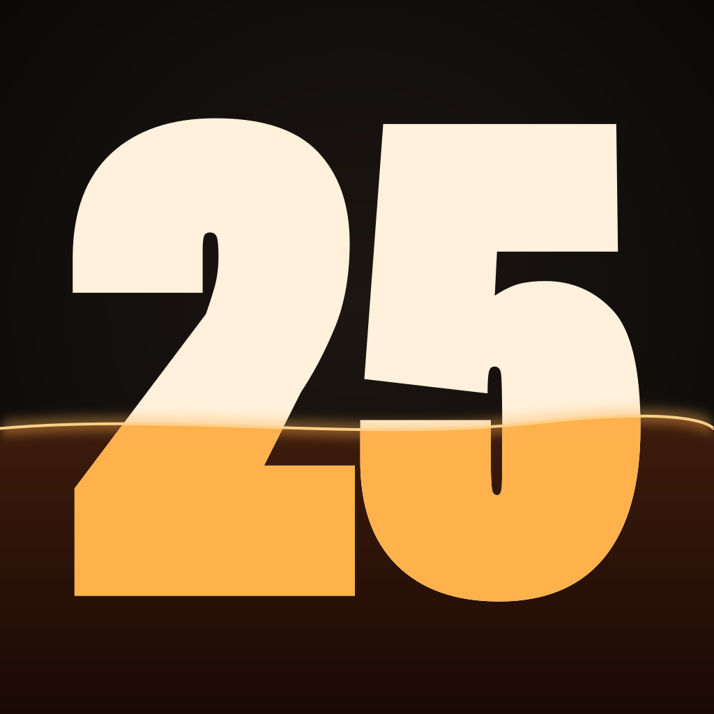

# Timer

A silent visual timer with the stopwatch on the same time axis. Scroll to a number and tap to start. The tide drains as time runs out, and at zero the screen floods with light and keeps counting overtime. `+` (below 1) starts a plain stopwatch.

One Flutter codebase for iOS and the web.

## Run

```sh
flutter run -d <your-iphone> --release   # phone (sign into Xcode > Settings > Accounts first)
flutter run -d web-server                # browser
flutter test                             # engine + layout tests
```

Web release: `flutter build web --release --wasm --no-web-resources-cdn`, then host `build/web` on any static host. It works offline after the first visit.

## How it's built

- `lib/engine/`: the session state machine. A timer and a stopwatch are one signed clock: negative is time left, positive is time counted.
- `lib/glyphs/`: Roboto Flex numerals baked into outlines by `tool/build_glyphs.py`. Width and weight are interpolated in Dart, so numbers fit the screen exactly on every platform.
- `lib/ui/`: layout (`geometry.dart`), painter (`scene.dart`), input, springs and frame loop (`stage.dart`).
- `shaders/world.frag`: one fragment shader paints the background, the tide and the flood, and re-colors anything under the waterline.

QA deep links (debug builds, or builds made with `--dart-define=QA=true`): `?scene=running,25,-754` (kind, minutes, signed seconds).

Font: Roboto Flex, SIL Open Font License 1.1.
